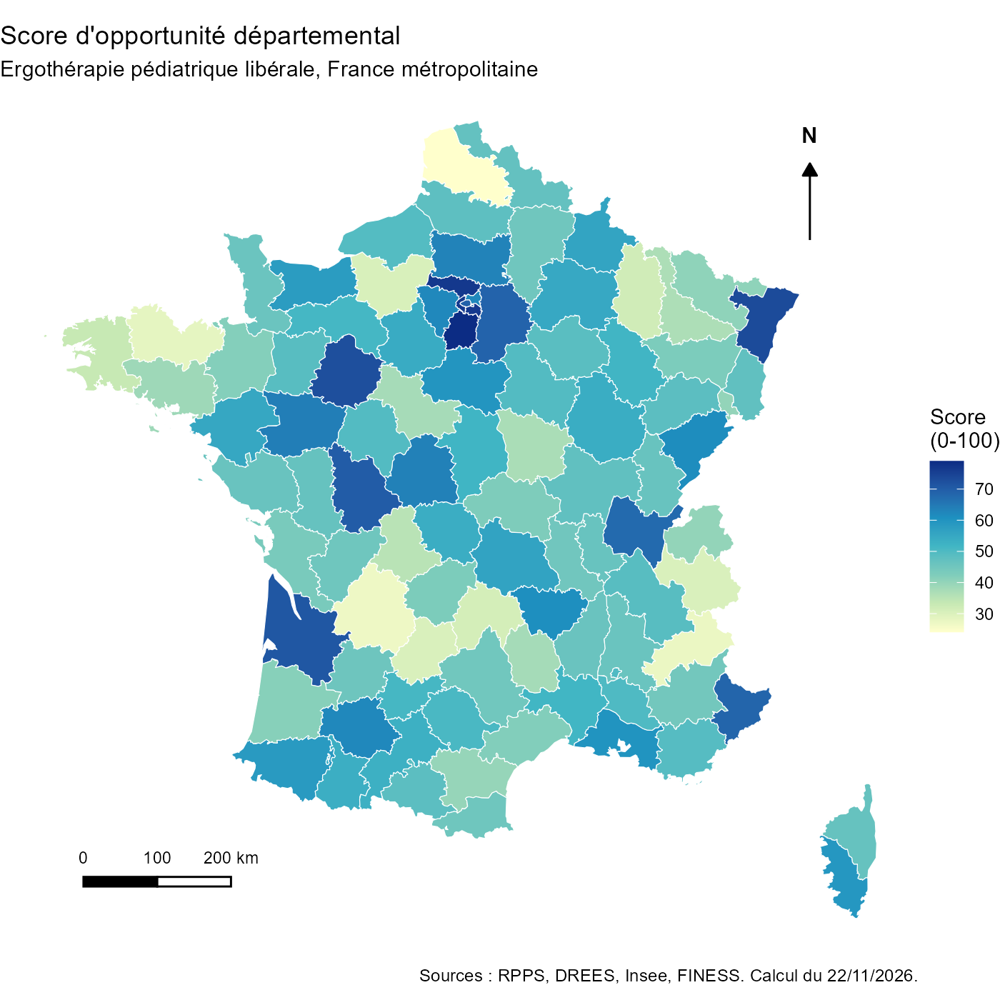

# Ergothérapie pédiatrique libérale : où s'installer ?

Où un ergothérapeute qui veut ouvrir un cabinet libéral pour enfants a-t-il le plus de chances de trouver une patientèle, aujourd'hui et d'ici 2035 ? Ce projet répond à l'échelle des départements, des intercommunalités et des communes de France métropolitaine, à partir de données publiques. Les résultats se consultent dans une application R Shiny.

**[Ouvrir l'application en ligne](https://labcoqarm.github.io/ergo-pediatrie-installation/)**

Projet personnel, octobre-novembre 2026.



## Résultats en bref

- La France métropolitaine compte 4 196 ergothérapeutes libéraux (RPPS, octobre 2026) pour 13,8 millions d'enfants de 0 à 17 ans, soit 3,04 pour 10 000 enfants. Cette densité nationale sert de référence pour calculer le besoin.
- Les départements les mieux placés sont en Île-de-France (Essonne, Val-d'Oise, Hauts-de-Seine, Val-de-Marne) : beaucoup d'enfants, peu d'ergothérapeutes libéraux par enfant, des revenus élevés. Hors Île-de-France viennent le Bas-Rhin, la Sarthe, la Gironde, la Vienne et les Alpes-Maritimes.
- Les moins favorables sont le Pas-de-Calais, la Dordogne et les Hautes-Alpes, où la densité d'ergothérapeutes est déjà forte et le nombre d'enfants en baisse.
- À l'échelle communale, les meilleurs scores hors Île-de-France se trouvent en périphérie des grandes villes : rive droite de Bordeaux (Saint-Louis-de-Montferrand, Ambarès-et-Lagrave, Izon), nord de Toulouse (Saint-Jory), sud de l'Oise.
- Le nombre d'enfants baisserait de 8 % d'ici 2035 (12,7 millions selon les projections Omphale). À densité constante, le besoin national diminue donc aussi : la projection dit surtout où l'offre est mal répartie, pas s'il manque des ergothérapeutes en France.

## L'application

Elle montre chaque indicateur sur trois échelles (départements, intercommunalités, communes), avec un classement, une recherche, un filtre « hors Île-de-France » et, au clic sur un territoire, sa projection du besoin et de l'offre de 2026 à 2035. Pour une commune, la carte dessine aussi sa zone de chalandise.

La [version en ligne](https://labcoqarm.github.io/ergo-pediatrie-installation/) tourne entièrement dans le navigateur (shinylive) : R et les données se téléchargent à la première ouverture, ce qui prend une à deux minutes. Pour la lancer sur son poste :

```r
install.packages(c("shiny", "leaflet", "sf", "jsonlite"))
shiny::runApp()
```

Les données de l'application sont déjà dans `resultats/carte_interactive/` : pas besoin de relancer la chaîne de calcul pour la consulter.

## Données

| Source | Contenu |
|---|---|
| [RPPS](https://www.data.gouv.fr/fr/datasets/annuaire-sante-extractions-des-donnees-en-libre-acces-des-professionnels-intervenant-dans-le-systeme-de-sante-rpps/) | Ergothérapeutes libéraux et leur commune d'exercice |
| [DREES](https://www.data.gouv.fr/fr/datasets/la-demographie-des-professionnels-de-sante-depuis-2012/) | Effectifs d'ergothérapeutes libéraux par département, 2016-2024 |
| [FINESS](https://www.data.gouv.fr/fr/datasets/finess-extraction-du-fichier-des-etablissements/) | CAMSP, CMPP et SESSAD géolocalisés (structures qui orientent les enfants vers un ergothérapeute) |
| Insee | Recensement 2022 (enfants par commune), Filosofi 2021 (niveau de vie), naissances 2008-2025, projections Omphale 2022 |
| IGN | Admin Express (communes, intercommunalités, départements), ROUTE 500 (réseau routier) |

Toutes ces données sont publiques. Les sources brutes (environ 1 Go) ne sont pas dans le dépôt : la chaîne les télécharge.

## Méthode

1. **Zone de chalandise de chaque commune.** Les temps de route entre communes sont calculés sur le réseau ROUTE 500 (algorithme de Dijkstra), avec une vitesse par type de route, un recalage sur des trajets connus et quelques minutes ajoutées dans les communes denses. Une commune compte entièrement dans la zone d'une autre jusqu'à 10 minutes de route, puis de moins en moins jusqu'à 30 minutes. C'est le principe de l'APL de la DREES, étendu à 30 minutes parce que les séances d'ergothérapie sont hebdomadaires.
2. **Concurrence.** Nombre d'ergothérapeutes libéraux accessibles pour 10 000 enfants, partagés avec les enfants de leur propre zone (méthode 2SFCA, la même que l'APL).
3. **Score communal (0-100).** Concurrence 35 %, enfants dans la zone 20 %, évolution des naissances 15 %, niveau de vie 15 %, CAMSP, CMPP et SESSAD 15 %. Chaque indicateur est converti en rang (percentile) avant pondération. Les communes avec moins de 2 000 enfants dans leur zone n'ont pas de score : le marché est trop petit pour un cabinet.
4. **Score départemental (0-100).** Concurrence 35 %, évolution projetée des enfants 2024-2035 25 %, niveau de vie 15 %, croissance récente des ergothérapeutes libéraux 10 % (une forte croissance annonce de la concurrence), structures adresseuses 15 %.
5. **Projection 2030-2035.** Enfants projetés (Omphale départemental, corrigé par l'évolution des naissances dans la zone, dans la limite de ±15 %) multipliés par la densité nationale actuelle. Deux hypothèses d'offre : figée au niveau de 2026, ou prolongeant la hausse 2016-2024 du département.

Une version précédente intégrait le taux d'AEEH (allocation d'éducation de l'enfant handicapé). Je l'ai retirée : le seul fichier communal disponible donnait des écarts peu crédibles entre départements (4,7 bénéficiaires pour 1 000 enfants dans l'Orne, 52 dans l'Hérault).

## Limites

- Le RPPS ne dit pas quels ergothérapeutes libéraux travaillent avec des enfants : la concurrence comprend tous les ergothérapeutes libéraux.
- Les plateformes de coordination et d'orientation (PCO TND), qui financent des bilans en libéral, ne sont pas prises en compte faute de fichier national.
- Le réseau routier est celui de ROUTE 500, édition 2021.
- Près des frontières, les enfants et les ergothérapeutes étrangers ne sont pas comptés. Les DROM ne sont pas traités.
- Les poids des scores sont un choix, réglable dans `chaine/e2_base.py` et `chaine/e4_scores.py`. La densité nationale n'est pas une norme médicale : un territoire « excédentaire » peut avoir des listes d'attente.
- Sur de petits effectifs, les évolutions en pourcentage s'envolent (passer de 1 à 13 ergothérapeutes donne +1 200 %).

## Relancer la chaîne de calcul

La chaîne est en Python (environnement Anaconda). Depuis la racine du projet :

```
pip install geopandas py7zr openpyxl pyogrio scipy shapely
python chaine/lancer.py
```

Premier lancement : environ 1 Go à télécharger et 5 à 10 minutes de calcul. Ensuite, la chaîne ne retélécharge que les sources qui ont changé et ne recalcule que si nécessaire. Sous Windows, `planifier_mise_a_jour.bat` crée une tâche qui lance la mise à jour le 1er de chaque mois. Les adresses des fichiers Insee changent à chaque édition : elles se mettent à jour à la main dans `chaine/config.py`.

- `chaine/config.py` : dossiers, paramètres du calcul, adresses des sources
- `chaine/e1_telecharger.py` : téléchargement des sources dans `donnees/brut/`
- `chaine/e2_base.py` : table communale et départementale, score départemental
- `chaine/e3_routes.py` : temps de route entre communes
- `chaine/e4_scores.py` : zones de chalandise, score communal, projections, intercommunalités
- `chaine/e5_export.py` : fichiers de l'application
- `chaine/lancer.py` : toute la chaîne dans l'ordre
- `app.R`, `R/donnees.R` : application Shiny
- `outils/figure_readme.R` : carte de ce README
- `outils/publier_site.R` : version web de l'application dans `docs/`, publiée par GitHub Pages
- `resultats/` : classements et projections en CSV, données de l'application

Armand Lecoq, novembre 2026.
